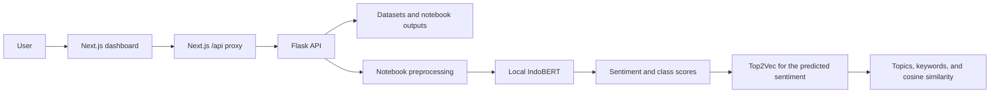

# IKN Sentiment Lab [Thesis]

A research dashboard for exploring public opinions about **Ibu Kota Nusantara (IKN)**, Indonesia's new capital, classifying sentiment with **IndoBERT**, and discovering discussion topics with **Top2Vec**. This repository contains the datasets, research notebooks, web application, API, and training and evaluation scripts.

The frontend uses Next.js, React, and TypeScript. The Flask backend runs the models locally, so the application does not require an AI service API key. Internet access is needed to install dependencies, prepare NLTK resources, and download the backbone for the first training run.

## Table of contents

- [Application features](#application-features)
- [Architecture and analysis flow](#architecture-and-analysis-flow)
- [Technology stack](#technology-stack)
- [Repository structure](#repository-structure)
- [Datasets and research results](#datasets-and-research-results)
- [Prerequisites](#prerequisites)
- [Installation and startup](#installation-and-startup)
- [Model setup](#model-setup)
- [API documentation and usage](#api-documentation-and-usage)
- [Environment configuration](#environment-configuration)
- [Testing and builds](#testing-and-builds)
- [Troubleshooting](#troubleshooting)
- [Limitations and interpretation](#limitations-and-interpretation)
- [Further documentation](#further-documentation)

## Application features

| Page | Route | Features |
| --- | --- | --- |
| Research dashboard | `/` | Opinion counts and dataset splits, sentiment proportions, train/validation/test comparisons, topic summaries, and model status |
| Sentence analysis | `/analysis` | Three-class sentiment prediction, scores for each class, preprocessed text, and the closest topics within the predicted sentiment |
| Opinion dataset | `/dataset` | Text search, dataset split and sentiment filters, pagination, expandable opinion text, and CSV export |
| Topic modelling | `/topics` | Topics grouped by sentiment, keywords, word weights where available, and coherence scores from notebook outputs or project training |
| Model evaluation | `/evaluation` | Accuracy, Macro F1, confusion matrix, precision, recall, F1, and support calculated from the notebook prediction CSV |

The content area uses a cream white palette with sage accents. The sidebar appears on desktop and becomes a collapsible menu on mobile. Charts and summaries use API data.

On the analysis page, **Ctrl/Cmd + Enter** submits a prediction. The page also provides example sentences, result copying, request cancellation, and an option to undo clearing the input. The latest sentence and result remain available while navigating between pages and reset when the page is reloaded.

CSV exports follow the active search and filters and include all matching rows, regardless of the current page. The dataset table supports 8, 16, 32, or 50 opinions per page.

## Architecture and analysis flow



For a new sentence, the backend cleans and tokenizes the text, removes words using the slang and stopword dictionaries and the English word corpus, and applies Sastrawi stemming. The result is passed to the IndoBERT tokenizer and a three-class classifier: `positive`, `neutral`, or `negative`.

The predicted sentiment determines which Top2Vec model searches for the closest topics. Results include up to three topics, keywords, word weights, document counts, and cosine similarity. If the topic model is unavailable or finds no match, the sentiment result is still returned with an explanation of the topic status.

The browser accesses `/api/*` through the frontend origin, and Next.js forwards requests to Flask. Models are loaded on first use and cached in memory within each backend process. Training runs through the CLI, separately from user requests.

## Technology stack

| Component | Technology |
| --- | --- |
| Frontend | Next.js `16.4.3`, React `19.2.7`, TypeScript `6.0.3`, CSS |
| Backend | Python, Flask `>=3.1,<4` |
| Sentiment classification | PyTorch, Transformers, safetensors, `indobenchmark/indobert-base-p1` |
| Preprocessing | NLTK, Sastrawi, local dictionaries |
| Topic modelling | Top2Vec with Doc2Vec embeddings; gensim for `c_v` coherence |
| API documentation | OpenAPI `3.0.3` and Swagger UI |
| Testing | Python `unittest`, the Node.js test runner, TypeScript, and production rendering checks |

Backend dependencies are listed in [requirements.txt](dashboard/requirements.txt), Top2Vec dependencies in [requirements-topics.txt](dashboard/requirements-topics.txt), and frontend versions in [package.json](dashboard/frontend/package.json) and its lockfile.

## Repository structure

```text
sentiment-analysis/
├── README.md
├── Makefile
├── data/
│   ├── raw/                 # Labelled opinion CSVs for exploration
│   ├── processed/           # TSV inputs for IndoBERT training and evaluation
│   ├── external/            # Slang and stopword dictionaries
│   └── predictions/         # Saved research prediction CSVs
├── notebooks/
│   ├── Preprocessing_Datasets_IKN.ipynb
│   ├── Sentimen_Analysis_IKN_IndoBERT.ipynb
│   └── Topic_Modelling_of_IKN.ipynb
└── dashboard/
    ├── README.md            # Application and research pipeline guide
    ├── config/              # Configuration from the primary notebook run
    ├── frontend/
    │   ├── src/app/         # Routes, layout, and stylesheets
    │   ├── src/components/  # Shared components and navigation
    │   ├── src/features/    # Page features
    │   ├── src/hooks/       # API resource fetching
    │   ├── src/lib/         # Data contracts and utilities
    │   └── tests/           # API client, topic, and rendering tests
    ├── server/              # Flask, preprocessing, inference, data, and OpenAPI
    ├── scripts/             # Setup, checkpoint import, training, and evaluation
    ├── tests/               # Backend tests
    ├── models/              # Local checkpoints; contents ignored by Git
    ├── reports/             # Local reports; contents ignored by Git
    ├── notebook_export.py   # Model export from a notebook runtime
    ├── requirements.txt
    ├── requirements-topics.txt
    └── run.py               # Backend entrypoint
```

Checkpoints, training outputs, caches, virtual environments, `node_modules`, Next.js builds, and `.env.local` configuration are excluded from GitHub. The `models/` and `reports/` directories are retained through `.gitkeep`; a fresh clone requires its own model setup.

## Datasets and research results

The original CSVs are used for exploration, while the preprocessed TSVs are used for IndoBERT training and evaluation. Their row counts differ:

| Split | Original CSV | Preprocessed TSV |
| --- | ---: | ---: |
| Train | 7,512 | 7,498 |
| Validation | 2,504 | 2,502 |
| Test | 2,504 | 2,501 |
| **Total** | **12,520** | **12,501** |

Across the original CSVs, the label distribution is **8,734 negative**, **1,846 neutral**, and **1,940 positive** opinions. The API uses the source labels `negative`, `neutral`, and `positive`.

The exploration CSVs contain `text` and `label` columns. Preprocessed TSVs contain two columns without a header: text and label. The research prediction CSVs contain `text`, `sentiment`, and `sentiment_predict` columns.

The evaluation page recalculates metrics from [test_with_predictions new.csv](<data/predictions/test_with_predictions new.csv>), which contains 2,501 opinions:

| Metric | Notebook result |
| --- | ---: |
| Accuracy | 77.61% |
| Macro F1 | 0.6393 |
| Positive F1 | 0.6454 |
| Neutral F1 | 0.4098 |
| Negative F1 | 0.8627 |

These figures come from saved research predictions. Local checkpoint evaluation runs separately through `scripts/evaluate.py` and may produce different metrics. The API checks the checkpoint fingerprint before serving a local evaluation report.

See the [data guide](data/README.md) and [notebook guide](notebooks/README.md) for source locations and the experiment workflow.

## Prerequisites

- Python **3.10 or newer**; the application guide uses Python 3.11/3.12.
- Node.js **20.9 or newer** and npm.
- Git; `make` is optional and provides shortcuts for common commands.
- Internet access for package installation, NLTK resources, and the initial training backbone download.
- A fine-tuned IndoBERT checkpoint for sentence predictions. A GPU is optional; serving uses the CPU by default.

Top2Vec dependencies are installed separately when needed for training or sentence-to-topic matching. Dataset exploration, historical evaluation, and notebook topic reports are available before local checkpoints are installed.

## Installation and startup

### 1. Clone the repository

```bash
git clone https://github.com/Ragraze/sentiment-analysis.git
cd sentiment-analysis
```

### 2. Set up the backend

From the repository root, run the following in the first terminal:

```bash
cd dashboard
python3 -m venv .venv
source .venv/bin/activate
python -m pip install -r requirements.txt
python scripts/setup_nltk.py
python run.py
```

The backend runs at **http://127.0.0.1:5000**. In Windows PowerShell, create the environment with `py -3 -m venv .venv`, activate it with `.\.venv\Scripts\Activate.ps1`, and then continue with the same `python` commands.

These steps are sufficient to serve dataset APIs and historical results. To enable sentence predictions, continue with [model setup](#model-setup). Missing checkpoints are reported through `/api/health` and the analysis service status panel.

On Linux/WSL, `bash scripts/setup_backend.sh` is available as an alternative. It installs CPU PyTorch, dependencies, and NLTK resources, runs tests, and attempts a real prediction. **Prepare the checkpoint before using this script**; without it, prediction verification fails even if dependency installation has completed.

### 3. Set up the frontend

Open a second terminal at the repository root:

```bash
cd dashboard/frontend
npm ci
npm run dev
```

Open **[http://localhost:3000](http://localhost:3000)**. Keep the backend and frontend running in their respective terminals. Stop either service with **Ctrl + C**.

### 4. Check the services

| Service | Local address |
| --- | --- |
| Dashboard | http://localhost:3000 |
| Backend information | http://127.0.0.1:5000/ |
| Model status | http://127.0.0.1:5000/api/health |
| Swagger UI | http://127.0.0.1:5000/api/docs/ |
| OpenAPI specification | http://127.0.0.1:5000/api/openapi.json |

Swagger is also available at http://localhost:3000/api/docs/ when both services are running.

For subsequent use, installation and training do not need to be repeated. Run these commands from the repository root in two separate terminals:

```bash
make backend
```

```bash
make frontend
```

Without `make`, run `dashboard/.venv/bin/python dashboard/run.py` for the backend and `npm --prefix dashboard/frontend run dev` for the frontend.

## Model setup

Run all commands in this section from `dashboard/` with the virtual environment active. For IndoBERT, either import an existing fine-tuned checkpoint or train a new one; only one of these steps is needed.

### Import an IndoBERT checkpoint from Colab

Provide your own fine-tuned model ZIP; archives and model weights are excluded from the repository. For example, if the archive has the following filename:

```bash
python scripts/import_checkpoint.py models/indobert_model_3e6.zip
```

The script installs the checkpoint into `models/indobert-ikn/`, checks the three-class classifier weights, normalizes the label configuration, and creates `serving.json`. An existing non-empty destination is not overwritten. To install another checkpoint, use `--output models/model-lain` and update `INDOBERT_MODEL_DIR`.

The checkpoint must contain a fine-tuned classifier rather than only a pretrained backbone. If the trained model is still available in the notebook runtime, follow the [Colab runtime export guide](dashboard/README.md#exporting-from-a-trained-notebook-runtime).

### Train IndoBERT on the project dataset

```bash
python scripts/train.py
python scripts/evaluate.py
```

Defaults come from [config/notebook.json](dashboard/config/notebook.json):

| Parameter | Default |
| --- | --- |
| Backbone | `indobenchmark/indobert-base-p1` |
| Label indices | `0: positive`, `1: neutral`, `2: negative` |
| Optimizer | Adam |
| Learning rate | `3e-6` |
| Epochs | `5` |
| Batch size | `32` |
| Maximum length | `512` tokens |
| Seed | `42` |
| Training device | CUDA when available, otherwise CPU |

Training uses the train and validation TSVs and saves the final-epoch checkpoint. Test evaluation runs separately and generates `reports/test.json` and `reports/test_with_predictions.csv`.

To adjust the device or batch size:

```bash
python scripts/train.py --batch-size 8 --device cpu
python scripts/train.py --help
python scripts/evaluate.py --help
```

CPU training can take a long time. Changing parameters can change the research results. The training script requires `--overwrite` to replace an existing checkpoint.

### Train Top2Vec

Once the checkpoint prediction CSV is available:

```bash
python -m pip install -r requirements-topics.txt
python scripts/setup_nltk.py
python scripts/train_topics.py
```

To use the saved research prediction CSV:

```bash
python scripts/train_topics.py --predictions "../data/predictions/test_with_predictions_and_coherence.csv"
```

The pipeline trains one model per sentiment using `doc2vec` embeddings, `speed=deep-learn`, and `min_count=10`, then calculates `c_v` coherence. Each sentiment requires at least 20 documents; successful clustering also depends on corpus diversity.

Outputs are saved to:

```text
models/top2vec/model_top2vec_positive
models/top2vec/model_top2vec_neutral
models/top2vec/model_top2vec_negative
reports/topics.json
```

Restart the backend after installing or replacing models. The topic page defaults to **Hasil training proyek** (Project training results). Select **Hasil notebook** (Notebook results) to view saved research outputs without retraining Top2Vec.

## API documentation and usage

- **Swagger UI:** http://127.0.0.1:5000/api/docs/
- **OpenAPI JSON:** http://127.0.0.1:5000/api/openapi.json

In Swagger, expand an endpoint, click **Try it out**, enter the parameters, and select **Execute**. Prediction requests run the local model and follow the API request limits.

| Method | Endpoint | Purpose |
| --- | --- | --- |
| `GET` | `/api/health` | Checkpoint and model status for IndoBERT and Top2Vec |
| `GET` | `/api/summary` | Opinion counts, sentiment distribution, dataset splits, and notebook topics |
| `GET` | `/api/dataset` | Opinion search and filtering with pagination |
| `GET` | `/api/dataset/export` | Export all filtered opinions as CSV |
| `POST` | `/api/predict` | Sentence sentiment prediction and topic matching |
| `GET` | `/api/topics` | Topic reports with `source=notebook` or `trained`; defaults to `notebook` |
| `GET` | `/api/evaluation` | Evaluation with `source=checkpoint` or `notebook`; defaults to `checkpoint` |

### Request examples

Check the service status and read a filtered dataset page:

```bash
curl http://127.0.0.1:5000/api/health
curl "http://127.0.0.1:5000/api/dataset?q=nusantara&split=test&label=negative&page=1&page_size=8"
```

Dataset parameters: `q` allows up to 200 characters; `split` accepts `all`, `train`, `val`, or `test`; `label` accepts `all`, `positive`, `neutral`, or `negative`; `page` starts at 1; and `page_size` accepts 1–50. Repeated query parameters are rejected.

Predict the sentiment of an Indonesian opinion:

```bash
curl -X POST http://127.0.0.1:5000/api/predict \
  -H 'Content-Type: application/json' \
  -d '{"text":"Saya mendukung pembangunan ibu kota Nusantara."}'
```

A successful response contains `label`, `confidence`, `scores`, `normalized`, `model`, `base_model`, and `topic_analysis`. Class scores range from 0 to 1. The topic status indicates whether a model is available and whether a matching topic was found.

Retrieve a topic report, historical evaluation, or CSV export:

```bash
curl "http://127.0.0.1:5000/api/topics?source=notebook"
curl "http://127.0.0.1:5000/api/evaluation?source=notebook"
curl "http://127.0.0.1:5000/api/dataset/export?split=test&label=negative" -o ikn-dataset.csv
```

### Validation and error responses

Predictions accept up to **2,000 characters** with a maximum request body of **16,384 bytes**. The backend allows **30 valid prediction attempts per minute per process** and **one active inference per process**.

| HTTP | Common cause |
| --- | --- |
| `400` | Invalid JSON, text, filters, or parameters |
| `403` | Request origin is not allowed |
| `413` | Request body is too large |
| `415` | Prediction request does not use `application/json` |
| `422` | Text is empty after preprocessing |
| `429` | Prediction limit reached; check the `Retry-After` header |
| `500` | Inference failed; check the backend logs |
| `503` | Checkpoint or data is unavailable, or the model is busy; busy responses include `Retry-After` |

`/api/health` can return HTTP 200 while the model is not ready; inspect `state` and `ready`. Topic and evaluation report endpoints can return HTTP 200 with `available=false` when a report is unavailable.

## Environment configuration

The defaults are sufficient for local use. Backend variables are read from the process environment; the backend does not automatically load `.env` files.

| Variable | Default | Purpose |
| --- | --- | --- |
| `INDOBERT_MODEL_DIR` | `dashboard/models/indobert-ikn/` | Fine-tuned IndoBERT checkpoint |
| `INDOBERT_DEVICE` | `cpu` | Serving device and default evaluation device |
| `IKN_DATA_DIR` | `data/` | Dataset directory containing `raw`, `processed`, `external`, and `predictions` |
| `IKN_NOTEBOOKS_DIR` | `notebooks/` | Original notebooks and saved outputs |
| `TOP2VEC_MODEL_DIR` | `dashboard/models/top2vec/` | Top2Vec models for each sentiment |
| `TOP2VEC_REPORT_DIR` | `dashboard/reports/` | Directory containing `topics.json` |
| `PORT` | `5000` | Backend port used by `run.py` |
| `FRONTEND_URL` | `http://localhost:3000` | Frontend origin allowed to submit predictions |
| `IKN_TRUSTED_HOSTS` | `localhost,127.0.0.1,[::1]` | Comma-separated list of allowed backend hosts |
| `FLASK_API_URL` | `http://127.0.0.1:5000` | Backend origin for the Next.js proxy |

Default paths above are resolved from the repository location. Use absolute paths for custom settings so they do not depend on the terminal's working directory.

For example, to run the backend on port 5001, from `dashboard/`:

```bash
PORT=5001 .venv/bin/python run.py
```

In the frontend terminal, from `dashboard/frontend/`:

```bash
cp .env.example .env.local
```

Set `.env.local` to:

```dotenv
FLASK_API_URL=http://127.0.0.1:5001
```

`FLASK_API_URL` must be an HTTP/HTTPS origin without a path, query, or credentials. Restart Next.js after changing it and rebuild for production. If the frontend port or domain changes, also update `FRONTEND_URL` in the backend environment.

## Testing and builds

From the repository root, after installing backend and frontend dependencies:

```bash
make test
make build
```

`make test` runs the backend tests, TypeScript checks, and frontend tests. `make build` creates the production frontend build.

| Command from the repository root | Purpose |
| --- | --- |
| `make backend` | Run Flask with `dashboard/.venv/bin/python` |
| `make frontend` | Start the Next.js development server |
| `make test-backend` | Run Python unittest |
| `make test-frontend` | Check TypeScript and run frontend tests |
| `make test` | Run the backend and frontend checks above |
| `make build` | Create a production Next.js build |

Use `make PYTHON=python3 test-backend` to select another interpreter with the required dependencies. Manual commands, including the production rendering check:

```bash
dashboard/.venv/bin/python -m unittest discover -s dashboard/tests -v
npm --prefix dashboard/frontend run typecheck
npm --prefix dashboard/frontend test
npm --prefix dashboard/frontend run build
npm --prefix dashboard/frontend run test:render
```

Tests cover data loading, notebook outputs, preprocessing, label ordering, tokenization, metric calculations, API contracts, OpenAPI, request limits, CSV export, and topic matching. Rendering checks verify all five routes, sidebar navigation, the mobile dialog, and production CSP headers and nonces.

Automated tests use test doubles for some model components. These checks do not replace prediction verification with real checkpoints and Top2Vec models.

To run the production frontend build from the repository root:

```bash
npm --prefix dashboard/frontend run build
npm --prefix dashboard/frontend start
```

Run the backend separately. `run.py` binds to `127.0.0.1` and uses Flask's built-in server for local use. Public deployment requires an appropriate WSGI server, reverse proxy, origin, and host configuration.

## Troubleshooting

| Symptom | Checks and next steps |
| --- | --- |
| Dashboard cannot load data | Confirm Flask is running, open `/api/summary` directly, and check `FLASK_API_URL` and the backend port |
| Prediction fails with `model_unavailable` | Check `INDOBERT_MODEL_DIR`, `serving.json`, safetensors weights, tokenizer files, and backend logs; install a fine-tuned checkpoint and restart |
| IndoBERT status remains `configured` | The checkpoint has been detected, but the model is loaded only on the first prediction; this state differs from `ready` |
| Missing `punkt_tab` or `words` resource | Run `python scripts/setup_nltk.py` from `dashboard/` using the same interpreter as the backend |
| Project topic results are unavailable | Train Top2Vec to create `reports/topics.json`, or select **Hasil notebook** (Notebook results) for historical outputs |
| Sentiment is returned, but no topic matches | Check Top2Vec status and vocabulary, and try a more complete IKN opinion; some sentences have no matching topic |
| Top2Vec reports `missing_dependency` | Install `requirements-topics.txt` in the backend environment and restart |
| HTTP 429 or a busy model | Wait for the duration in `Retry-After`, then retry |
| HTTP 403 on prediction | Match `FRONTEND_URL` to the frontend origin, including its port |
| HTTP 400 after changing the backend host | Check the allowed host list in `IKN_TRUSTED_HOSTS` |
| Checkpoint evaluation returns `available=false` | Run `python scripts/evaluate.py`; repeat after replacing the checkpoint because the report checks the model fingerprint |
| CUDA is unavailable or memory is insufficient | Use CPU, reduce the training/evaluation batch size, or install PyTorch for the intended device |
| Automated setup stops at the final step | Check whether the checkpoint is installed; the script's final step attempts a real prediction |

Frontend requests time out after one minute. The first prediction may take longer because the model must be loaded. Cancelling stops the browser from waiting; computation already accepted by the backend may continue.

## Limitations and interpretation

- The dataset is dominated by negative sentiment. Read Macro F1 and per-class metrics alongside accuracy to understand model performance.
- Preprocessing preserves the notebook's behaviour, including removing slang, stopwords, and English words. Some sentiment information may be lost; changing the pipeline requires rebuilding the dataset and fine-tuning again.
- `confidence` comes from the classifier's softmax output. It is a model score, not a guarantee of correctness or a calibrated probability estimate.
- Topic similarity uses cosine in the range **−1 to 1**. It differs from sentiment confidence and is not presented as a probability.
- `c_v` coherence measures how related topic words are within the corpus, rather than how well a topic fits one new sentence.
- Top2Vec discovers topics within each sentiment corpus. Topic numbers apply only within that group and may change after retraining.
- Notebook results and local checkpoint results have different sources. The same seed does not guarantee identical training results across devices and dependency versions.
- Request limits and model caches apply per backend process. Additional workers increase process count, memory usage, and the aggregate request allowance.

## Further documentation

- [Application guide](dashboard/README.md): installation, checkpoint import, Colab export, preprocessing/tokenization, training, evaluation, and Top2Vec.
- [Dataset guide](data/README.md): research source file locations.
- [Notebook guide](notebooks/README.md): preprocessing, sentiment analysis, and topic modelling workflow.
- [Notebook configuration](dashboard/config/notebook.json): primary-run parameters used by the CLI.
- [OpenAPI definition](dashboard/server/openapi.py): endpoint schemas and contracts served through Swagger.

Technology references are listed in the [application guide's references](dashboard/README.md#references).
