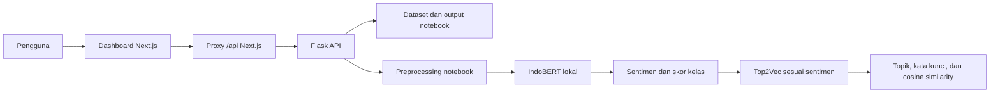

# IKN Sentiment Lab [Thesis]

Dashboard penelitian untuk mengeksplorasi opini tentang **Ibu Kota Nusantara (IKN)**, mengklasifikasikan sentimen dengan **IndoBERT**, dan memodelkan topik percakapan dengan **Top2Vec**. Repository ini menyimpan dataset, notebook penelitian, aplikasi web, API, serta skrip training dan evaluasi.

Frontend memakai Next.js, React, dan TypeScript; backend memakai Flask dan menjalankan model secara lokal. Aplikasi tidak memerlukan API key layanan AI. Akses internet diperlukan saat memasang dependensi, menyiapkan resource NLTK, dan mengunduh backbone untuk training pertama.

## Daftar isi

- [Fitur aplikasi](#fitur-aplikasi)
- [Arsitektur dan alur analisis](#arsitektur-dan-alur-analisis)
- [Teknologi](#teknologi)
- [Struktur repository](#struktur-repository)
- [Dataset dan hasil penelitian](#dataset-dan-hasil-penelitian)
- [Prasyarat](#prasyarat)
- [Instalasi dan menjalankan aplikasi](#instalasi-dan-menjalankan-aplikasi)
- [Menyiapkan model](#menyiapkan-model)
- [Dokumentasi dan penggunaan API](#dokumentasi-dan-penggunaan-api)
- [Konfigurasi environment](#konfigurasi-environment)
- [Pengujian dan build](#pengujian-dan-build)
- [Troubleshooting](#troubleshooting)
- [Batasan dan interpretasi hasil](#batasan-dan-interpretasi-hasil)
- [Panduan lanjutan](#panduan-lanjutan)

## Fitur aplikasi

| Halaman | Route | Fitur |
| --- | --- | --- |
| Dashboard penelitian | `/` | Jumlah opini dan pembagian dataset, proporsi sentimen, perbandingan train/validation/test, ringkasan topik, dan status model |
| Analisis kalimat | `/analysis` | Prediksi tiga sentimen, skor setiap kelas, teks hasil preprocessing, dan topik terdekat sesuai sentimen |
| Dataset opini | `/dataset` | Pencarian teks, filter bagian data dan sentimen, pagination, perluasan teks panjang, serta ekspor CSV |
| Pemodelan topik | `/topics` | Kelompok topik per sentimen, kata kunci, bobot kata jika tersedia, dan coherence score dari notebook atau training proyek |
| Evaluasi model | `/evaluation` | Akurasi, Macro F1, confusion matrix, precision, recall, F1, dan support dari CSV prediksi notebook |

Area konten menggunakan warna cream white dengan aksen sage. Sidebar tersedia di desktop dan menjadi menu yang bisa dibuka di ponsel. Grafik dan ringkasan memakai data API.

Pada halaman analisis, **Ctrl/Cmd + Enter** menjalankan prediksi. Tersedia contoh kalimat, salin hasil, pembatalan request, dan urungkan pengosongan isian. Kalimat dan hasil terakhir bertahan saat berpindah menu, lalu kosong ketika halaman dimuat ulang.

Ekspor CSV mengikuti pencarian dan filter aktif, mencakup seluruh hasil filter tanpa dibatasi halaman yang sedang dibuka. Tabel menyediakan pilihan 8, 16, 32, atau 50 opini per halaman.

## Arsitektur dan alur analisis



Untuk kalimat baru, backend membersihkan teks, melakukan tokenisasi, menghapus kata sesuai kamus slang/stopword serta korpus kata Inggris, lalu menjalankan stemming Sastrawi. Teks tersebut masuk ke tokenizer IndoBERT dan classifier tiga kelas: `positive`, `neutral`, atau `negative`.

Sentimen yang diprediksi menentukan model Top2Vec yang digunakan untuk mencari topik terdekat. Hasil menampilkan hingga tiga topik, kata kunci, bobot, jumlah dokumen, dan kemiripan cosine. Jika model topik belum tersedia atau tidak menemukan kecocokan, hasil sentimen tetap dikembalikan dengan penjelasan status topik.

Browser mengakses `/api/*` melalui origin frontend; Next.js meneruskan request ke Flask. Model dimuat saat pertama kali dipakai dan disimpan dalam memori setiap proses backend. Training dijalankan lewat CLI, terpisah dari request pengguna.

## Teknologi

| Bagian | Teknologi |
| --- | --- |
| Frontend | Next.js `16.4.3`, React `19.2.7`, TypeScript `6.0.3`, CSS |
| Backend | Python, Flask `>=3.1,<4` |
| Klasifikasi sentimen | PyTorch, Transformers, safetensors, `indobenchmark/indobert-base-p1` |
| Preprocessing | NLTK, Sastrawi, kamus lokal |
| Pemodelan topik | Top2Vec dengan embedding Doc2Vec; gensim untuk coherence `c_v` |
| Dokumentasi API | OpenAPI `3.0.3` dan Swagger UI |
| Pengujian | Python `unittest`, Node.js test runner, TypeScript, pemeriksaan render produksi |

Dependensi backend ada di [requirements.txt](dashboard/requirements.txt), dependensi Top2Vec di [requirements-topics.txt](dashboard/requirements-topics.txt), dan versi frontend di [package.json](dashboard/frontend/package.json) beserta lockfile-nya.

## Struktur repository

```text
sentiment-analysis/
├── README.md
├── Makefile
├── data/
│   ├── raw/                 # CSV opini berlabel untuk eksplorasi
│   ├── processed/           # TSV input training dan evaluasi IndoBERT
│   ├── external/            # Kamus slang dan stopword
│   └── predictions/         # CSV prediksi penelitian yang tersimpan
├── notebooks/
│   ├── Preprocessing_Datasets_IKN.ipynb
│   ├── Sentimen_Analysis_IKN_IndoBERT.ipynb
│   └── Topic_Modelling_of_IKN.ipynb
└── dashboard/
    ├── README.md            # Panduan teknis aplikasi dan pipeline penelitian
    ├── config/              # Konfigurasi primary run notebook
    ├── frontend/
    │   ├── src/app/         # Route, layout, dan stylesheet
    │   ├── src/components/  # Komponen bersama dan navigasi
    │   ├── src/features/    # Fitur tiap halaman
    │   ├── src/hooks/       # Pengambilan resource API
    │   ├── src/lib/         # Kontrak data dan utilitas
    │   └── tests/           # Pengujian API client, topik, dan render
    ├── server/              # Flask, preprocessing, inference, data, dan OpenAPI
    ├── scripts/             # Setup, impor checkpoint, training, dan evaluasi
    ├── tests/               # Pengujian backend
    ├── models/              # Checkpoint lokal; isinya diabaikan Git
    ├── reports/             # Laporan lokal; isinya diabaikan Git
    ├── notebook_export.py   # Ekspor model dari runtime notebook
    ├── requirements.txt
    ├── requirements-topics.txt
    └── run.py               # Entrypoint backend
```

Checkpoint, hasil training, cache, virtual environment, `node_modules`, build Next.js, dan konfigurasi `.env.local` tidak disimpan di GitHub. Folder `models/` dan `reports/` dipertahankan melalui `.gitkeep`; clone baru perlu menyiapkan model sendiri.

## Dataset dan hasil penelitian

CSV asli digunakan untuk eksplorasi; TSV hasil preprocessing digunakan untuk training dan evaluasi IndoBERT. Jumlah baris keduanya berbeda:

| Bagian | CSV asli | TSV hasil preprocessing |
| --- | ---: | ---: |
| Train | 7.512 | 7.498 |
| Validation | 2.504 | 2.502 |
| Test | 2.504 | 2.501 |
| **Total** | **12.520** | **12.501** |

Distribusi label pada seluruh CSV asli adalah **8.734 negatif**, **1.846 netral**, dan **1.940 positif**. Label sumber tetap ditampilkan sebagai `negative`, `neutral`, dan `positive` pada API.

File CSV eksplorasi memiliki kolom `text` dan `label`. TSV hasil preprocessing memiliki dua kolom tanpa header: teks dan label. CSV prediksi penelitian menyimpan kolom `text`, `sentiment`, dan `sentiment_predict`.

Halaman evaluasi menghitung ulang metrik dari [test_with_predictions new.csv](<data/predictions/test_with_predictions new.csv>), berisi 2.501 opini:

| Metrik | Hasil notebook |
| --- | ---: |
| Akurasi | 77,61% |
| Macro F1 | 0,6393 |
| F1 positif | 0,6454 |
| F1 netral | 0,4098 |
| F1 negatif | 0,8627 |

Angka tersebut berasal dari prediksi penelitian yang tersimpan. Evaluasi checkpoint lokal dilakukan terpisah melalui `scripts/evaluate.py`; hasilnya dapat berbeda dari metrik notebook. API memeriksa fingerprint checkpoint sebelum menyajikan laporan evaluasi lokal.

Lihat [keterangan data](data/README.md) dan [urutan notebook](notebooks/README.md) untuk penempatan sumber dan alur eksperimen.

## Prasyarat

- Python **3.10 atau lebih baru**; panduan aplikasi menggunakan Python 3.11/3.12.
- Node.js **20.9 atau lebih baru** dan npm.
- Git; `make` bersifat opsional untuk menjalankan perintah ringkas.
- Internet untuk instalasi paket, resource NLTK, serta unduhan awal backbone training.
- Checkpoint IndoBERT hasil fine-tuning untuk prediksi kalimat. GPU bersifat opsional; serving memakai CPU secara default.

Dependensi Top2Vec dipasang terpisah saat diperlukan untuk training atau pencocokan topik kalimat. Eksplorasi data, evaluasi historis, dan laporan topik notebook dapat digunakan sebelum checkpoint lokal terpasang.

## Instalasi dan menjalankan aplikasi

### 1. Clone repository

```bash
git clone https://github.com/Ragraze/sentiment-analysis.git
cd sentiment-analysis
```

### 2. Siapkan backend

Dari folder utama repository, jalankan pada terminal pertama:

```bash
cd dashboard
python3 -m venv .venv
source .venv/bin/activate
python -m pip install -r requirements.txt
python scripts/setup_nltk.py
python run.py
```

Backend berjalan di **http://127.0.0.1:5000**. Pada Windows PowerShell, gunakan `py -3 -m venv .venv` untuk membuat environment dan `.\.venv\Scripts\Activate.ps1` untuk mengaktifkannya, lalu lanjutkan perintah `python` yang sama.

Langkah ini sudah cukup untuk menjalankan API dataset dan hasil historis. Untuk menggunakan prediksi kalimat, lanjutkan [penyiapan model](#menyiapkan-model). Status checkpoint yang belum tersedia dapat dilihat di `/api/health` dan panel layanan analisis.

Pada Linux/WSL, tersedia alternatif `bash scripts/setup_backend.sh`. Skrip memasang PyTorch CPU, dependensi, resource NLTK, menjalankan tes, lalu mencoba prediksi sungguhan. **Siapkan checkpoint terlebih dahulu jika memakai skrip ini**; tanpa checkpoint, tahap verifikasi prediksi akan gagal walaupun instalasi dependensi sudah selesai.

### 3. Siapkan frontend

Buka terminal kedua dari folder utama repository:

```bash
cd dashboard/frontend
npm ci
npm run dev
```

Buka **[http://localhost:3000](http://localhost:3000)**. Backend dan frontend perlu tetap berjalan pada terminal masing-masing. Hentikan layanan dengan **Ctrl + C**.

### 4. Periksa layanan

| Layanan | Alamat lokal |
| --- | --- |
| Dashboard | http://localhost:3000 |
| Informasi backend | http://127.0.0.1:5000/ |
| Status model | http://127.0.0.1:5000/api/health |
| Swagger UI | http://127.0.0.1:5000/api/docs/ |
| Spesifikasi OpenAPI | http://127.0.0.1:5000/api/openapi.json |

Swagger juga dapat dibuka melalui http://localhost:3000/api/docs/ ketika kedua layanan berjalan.

Untuk pemakaian berikutnya, tidak perlu mengulang instalasi atau training. Jalankan dari folder utama pada dua terminal terpisah:

```bash
make backend
```

```bash
make frontend
```

Jika tidak memakai `make`, jalankan `dashboard/.venv/bin/python dashboard/run.py` untuk backend dan `npm --prefix dashboard/frontend run dev` untuk frontend.

## Menyiapkan model

Semua perintah pada bagian ini dijalankan dari folder `dashboard/` dengan virtual environment aktif. Pilih impor checkpoint yang sudah dilatih atau training baru untuk IndoBERT; keduanya tidak perlu dijalankan bersamaan.

### Mengimpor checkpoint IndoBERT dari Colab

Siapkan ZIP hasil fine-tuning sendiri; arsip dan bobot model tidak disertakan dalam repository. Contoh jika ZIP disimpan dengan nama berikut:

```bash
python scripts/import_checkpoint.py models/indobert_model_3e6.zip
```

Skrip memasang checkpoint di `models/indobert-ikn/`, memeriksa bobot classifier tiga kelas, merapikan konfigurasi label, dan membuat `serving.json`. Folder tujuan yang sudah berisi file tidak ditimpa. Untuk checkpoint lain, gunakan `--output models/model-lain`, lalu sesuaikan `INDOBERT_MODEL_DIR`.

Checkpoint harus berisi model hasil fine-tuning, bukan hanya backbone pretrained. Jika model masih tersedia di runtime notebook, gunakan [panduan ekspor runtime Colab](dashboard/README.md#ekspor-dari-runtime-notebook-yang-sudah-dilatih).

### Melatih IndoBERT dari dataset proyek

```bash
python scripts/train.py
python scripts/evaluate.py
```

Konfigurasi default berasal dari [config/notebook.json](dashboard/config/notebook.json):

| Parameter | Default |
| --- | --- |
| Backbone | `indobenchmark/indobert-base-p1` |
| Indeks label | `0: positive`, `1: neutral`, `2: negative` |
| Optimizer | Adam |
| Learning rate | `3e-6` |
| Epoch | `5` |
| Batch size | `32` |
| Panjang maksimum | `512` token |
| Seed | `42` |
| Perangkat training | CUDA jika tersedia, selain itu CPU |

Training memakai TSV train dan validation; checkpoint akhir disimpan sesuai epoch terakhir. Evaluasi test dijalankan terpisah dan menghasilkan `reports/test.json` serta `reports/test_with_predictions.csv`.

Untuk menyesuaikan perangkat atau batch size:

```bash
python scripts/train.py --batch-size 8 --device cpu
python scripts/train.py --help
python scripts/evaluate.py --help
```

Training CPU dapat memerlukan waktu lama. Mengubah parameter dapat mengubah hasil penelitian. Skrip training memerlukan `--overwrite` untuk mengganti checkpoint yang sudah ada.

### Melatih Top2Vec

Setelah CSV prediksi checkpoint tersedia:

```bash
python -m pip install -r requirements-topics.txt
python scripts/setup_nltk.py
python scripts/train_topics.py
```

Untuk memakai CSV prediksi penelitian yang sudah tersimpan:

```bash
python scripts/train_topics.py --predictions "../data/predictions/test_with_predictions_and_coherence.csv"
```

Pipeline membentuk satu model per sentimen menggunakan embedding `doc2vec`, `speed=deep-learn`, dan `min_count=10`, lalu menghitung coherence `c_v`. Setiap sentimen membutuhkan minimal 20 dokumen; keberhasilan pembentukan cluster juga bergantung pada keragaman korpus.

Hasil disimpan di:

```text
models/top2vec/model_top2vec_positive
models/top2vec/model_top2vec_neutral
models/top2vec/model_top2vec_negative
reports/topics.json
```

Restart backend setelah memasang atau mengganti model. Halaman topik memakai sumber **Hasil training proyek** secara default; pilih **Hasil notebook** untuk melihat output penelitian yang sudah tersimpan tanpa melatih ulang Top2Vec.

## Dokumentasi dan penggunaan API

- **Swagger UI:** http://127.0.0.1:5000/api/docs/
- **OpenAPI JSON:** http://127.0.0.1:5000/api/openapi.json

Pada Swagger, buka endpoint, klik **Try it out**, isi parameter, lalu **Execute**. Request prediksi menjalankan model lokal sungguhan dan mengikuti batas pemakaian API.

| Method | Endpoint | Kegunaan |
| --- | --- | --- |
| `GET` | `/api/health` | Status checkpoint dan model IndoBERT/Top2Vec |
| `GET` | `/api/summary` | Jumlah opini, distribusi sentimen, pembagian data, dan topik notebook |
| `GET` | `/api/dataset` | Pencarian dan filter opini dengan pagination |
| `GET` | `/api/dataset/export` | Ekspor seluruh hasil filter ke CSV |
| `POST` | `/api/predict` | Prediksi sentimen dan pencocokan topik kalimat |
| `GET` | `/api/topics` | Laporan topik dengan `source=notebook` atau `trained`; default `notebook` |
| `GET` | `/api/evaluation` | Evaluasi dengan `source=checkpoint` atau `notebook`; default `checkpoint` |

### Contoh request

Periksa status dan baca dataset terfilter:

```bash
curl http://127.0.0.1:5000/api/health
curl "http://127.0.0.1:5000/api/dataset?q=nusantara&split=test&label=negative&page=1&page_size=8"
```

Parameter dataset: `q` maksimal 200 karakter; `split` berupa `all`, `train`, `val`, atau `test`; `label` berupa `all`, `positive`, `neutral`, atau `negative`; `page` dimulai dari 1; `page_size` menerima 1–50. Parameter tidak boleh berulang.

Prediksi satu opini:

```bash
curl -X POST http://127.0.0.1:5000/api/predict \
  -H 'Content-Type: application/json' \
  -d '{"text":"Saya mendukung pembangunan ibu kota Nusantara."}'
```

Respons berhasil memiliki `label`, `confidence`, `scores`, `normalized`, `model`, `base_model`, dan `topic_analysis`. Skor kelas berada pada rentang 0–1. Status topik menjelaskan apakah model tersedia dan apakah kalimat cocok dengan suatu topik.

Ambil laporan topik, evaluasi penelitian, atau unduh CSV:

```bash
curl "http://127.0.0.1:5000/api/topics?source=notebook"
curl "http://127.0.0.1:5000/api/evaluation?source=notebook"
curl "http://127.0.0.1:5000/api/dataset/export?split=test&label=negative" -o ikn-dataset.csv
```

### Validasi dan respons gagal

Prediksi menerima teks maksimal **2.000 karakter** dengan body request maksimal **16.384 byte**. Backend membatasi **30 percobaan prediksi valid per menit per proses** dan **satu inferensi aktif per proses**.

| HTTP | Penyebab umum |
| --- | --- |
| `400` | JSON, teks, filter, atau parameter tidak valid |
| `403` | Origin request tidak diizinkan |
| `413` | Body request terlalu besar |
| `415` | Request prediksi tidak memakai `application/json` |
| `422` | Teks kosong setelah preprocessing |
| `429` | Batas prediksi tercapai; lihat header `Retry-After` |
| `500` | Inferensi gagal; lihat log backend |
| `503` | Checkpoint/data belum tersedia atau model sedang sibuk; kondisi sibuk menyertakan `Retry-After` |

`/api/health` tetap dapat mengembalikan HTTP 200 saat model belum siap; periksa `state` dan `ready`. Endpoint laporan topik/evaluasi dapat mengembalikan HTTP 200 dengan `available=false` bila laporan belum tersedia.

## Konfigurasi environment

Nilai default sudah cukup untuk penggunaan lokal. Variabel backend dibaca dari environment proses; backend tidak memuat file `.env` secara otomatis.

| Variabel | Default | Fungsi |
| --- | --- | --- |
| `INDOBERT_MODEL_DIR` | `dashboard/models/indobert-ikn/` | Checkpoint IndoBERT hasil fine-tuning |
| `INDOBERT_DEVICE` | `cpu` | Perangkat serving dan default evaluasi |
| `IKN_DATA_DIR` | `data/` | Dataset dengan subfolder `raw`, `processed`, `external`, dan `predictions` |
| `IKN_NOTEBOOKS_DIR` | `notebooks/` | Notebook asli beserta output tersimpan |
| `TOP2VEC_MODEL_DIR` | `dashboard/models/top2vec/` | Model Top2Vec per sentimen |
| `TOP2VEC_REPORT_DIR` | `dashboard/reports/` | Lokasi laporan `topics.json` |
| `PORT` | `5000` | Port backend pada `run.py` |
| `FRONTEND_URL` | `http://localhost:3000` | Origin frontend yang diizinkan untuk prediksi |
| `IKN_TRUSTED_HOSTS` | `localhost,127.0.0.1,[::1]` | Host backend yang diizinkan, dipisahkan koma |
| `FLASK_API_URL` | `http://127.0.0.1:5000` | Origin backend untuk proxy Next.js |

Path default di atas dihitung dari lokasi repository. Untuk konfigurasi path sendiri, gunakan path absolut agar tidak bergantung pada direktori terminal.

Contoh bila backend ingin dijalankan pada port 5001, dari folder `dashboard/`:

```bash
PORT=5001 .venv/bin/python run.py
```

Pada terminal frontend, dari folder `dashboard/frontend/`:

```bash
cp .env.example .env.local
```

Ubah isi `.env.local` menjadi:

```dotenv
FLASK_API_URL=http://127.0.0.1:5001
```

`FLASK_API_URL` harus berupa origin HTTP/HTTPS tanpa path, query, atau kredensial. Restart Next.js setelah mengubahnya; lakukan build ulang untuk produksi. Jika port atau domain frontend berubah, sesuaikan juga `FRONTEND_URL` di backend.

## Pengujian dan build

Dari folder utama repository, setelah dependensi backend dan frontend terpasang:

```bash
make test
make build
```

`make test` menjalankan tes backend, pemeriksaan TypeScript, dan tes frontend. `make build` membuat build frontend produksi.

| Perintah dari root | Fungsi |
| --- | --- |
| `make backend` | Menjalankan Flask menggunakan `dashboard/.venv/bin/python` |
| `make frontend` | Menjalankan server development Next.js |
| `make test-backend` | Menjalankan Python unittest |
| `make test-frontend` | Memeriksa TypeScript dan menjalankan tes frontend |
| `make test` | Menjalankan seluruh pemeriksaan di atas |
| `make build` | Membuat build Next.js produksi |

Gunakan `make PYTHON=python3 test-backend` jika memakai interpreter lain yang sudah memiliki dependensi. Perintah manual dan pemeriksaan render produksi:

```bash
dashboard/.venv/bin/python -m unittest discover -s dashboard/tests -v
npm --prefix dashboard/frontend run typecheck
npm --prefix dashboard/frontend test
npm --prefix dashboard/frontend run build
npm --prefix dashboard/frontend run test:render
```

Tes mencakup pembacaan data, output notebook, preprocessing, urutan label, tokenisasi, perhitungan metrik, kontrak API, OpenAPI, pembatasan request, CSV, dan perilaku pencocokan topik. Pemeriksaan render memverifikasi kelima route, navigasi sidebar, dialog ponsel, serta header dan nonce CSP pada build produksi.

Pengujian otomatis memakai test double untuk bagian model tertentu. Keberhasilan tes tersebut tidak menggantikan verifikasi prediksi dengan checkpoint dan model Top2Vec sungguhan.

Untuk menjalankan build frontend produksi, dari root:

```bash
npm --prefix dashboard/frontend run build
npm --prefix dashboard/frontend start
```

Backend tetap dijalankan terpisah. `run.py` mengikat server ke `127.0.0.1` dan menggunakan server bawaan Flask untuk penggunaan lokal; deployment publik memerlukan pengaturan server WSGI, reverse proxy, origin, dan host yang sesuai.

## Troubleshooting

| Gejala | Pemeriksaan dan langkah |
| --- | --- |
| Dashboard gagal memuat data | Pastikan Flask berjalan, buka `/api/summary` langsung, lalu cek `FLASK_API_URL` dan port backend |
| Prediksi gagal dengan `model_unavailable` | Periksa `INDOBERT_MODEL_DIR`, `serving.json`, bobot safetensors, tokenizer, serta log backend; pasang checkpoint hasil fine-tuning dan restart |
| Status IndoBERT masih `configured` | Checkpoint terdeteksi, tetapi model baru dimuat saat prediksi pertama; status ini berbeda dari `ready` |
| Resource `punkt_tab` atau `words` tidak ditemukan | Jalankan `python scripts/setup_nltk.py` dari `dashboard/` dengan interpreter backend yang sama |
| Hasil training topik belum tersedia | Latih Top2Vec untuk membuat `reports/topics.json`, atau pilih sumber **Hasil notebook** untuk laporan historis |
| Sentimen tampil, tetapi topik tidak cocok | Periksa status Top2Vec dan kosakata model; gunakan kalimat IKN yang lebih lengkap. Kalimat dapat tidak memiliki kecocokan topik |
| Top2Vec berstatus `missing_dependency` | Pasang `requirements-topics.txt` pada environment backend, lalu restart |
| HTTP 429 atau model sibuk | Tunggu sesuai `Retry-After`, lalu kirim ulang prediksi |
| HTTP 403 pada prediksi | Cocokkan `FRONTEND_URL` dengan origin frontend, termasuk port |
| HTTP 400 setelah mengganti host backend | Periksa daftar host yang diizinkan pada `IKN_TRUSTED_HOSTS` |
| Evaluasi checkpoint `available=false` | Jalankan `python scripts/evaluate.py`; ulangi setelah mengganti checkpoint karena laporan memeriksa fingerprint model |
| CUDA tidak tersedia atau memori tidak cukup | Gunakan CPU, kurangi batch size training/evaluasi, atau pasang PyTorch yang sesuai perangkat |
| Setup otomatis berhenti di akhir | Periksa apakah checkpoint sudah terpasang; tahap terakhir skrip mencoba prediksi sungguhan |

Request frontend memiliki timeout satu menit. Prediksi pertama dapat lebih lambat karena model baru dimuat. Tombol batalkan menghentikan penantian di browser; komputasi yang sudah diterima backend dapat tetap berjalan.

## Batasan dan interpretasi hasil

- Dataset didominasi sentimen negatif. Baca Macro F1 dan metrik per kelas bersama akurasi untuk memahami hasil model.
- Preprocessing mempertahankan perilaku notebook, termasuk penghapusan kata slang, stopword, dan kata Inggris. Sebagian informasi sentimen dapat hilang; perubahan pipeline memerlukan penyiapan dataset dan fine-tuning ulang.
- Skor `confidence` berasal dari softmax classifier. Nilai tersebut merupakan skor model, bukan jaminan kebenaran atau pengukuran probabilitas yang sudah dikalibrasi.
- Kemiripan topik memakai cosine pada rentang **−1 sampai 1**. Nilai ini berbeda dari confidence sentimen dan tidak ditampilkan sebagai probabilitas.
- Coherence `c_v` menilai keterkaitan kata topik pada korpus, bukan ketepatan topik untuk satu kalimat baru.
- Top2Vec membentuk topik dari korpus tiap sentimen. Nomor topik hanya berlaku dalam kelompok tersebut dan dapat berubah saat training diulang.
- Hasil notebook dan checkpoint lokal memiliki sumber berbeda. Seed yang sama tidak menjamin hasil training identik pada perangkat dan versi dependensi berbeda.
- Batas request dan cache model berlaku per proses backend. Menambah worker menambah proses, penggunaan memori, dan batas request agregat.

## Panduan lanjutan

- [Panduan aplikasi](dashboard/README.md): instalasi, impor checkpoint, ekspor Colab, preprocessing/tokenisasi, training, evaluasi, dan Top2Vec.
- [Keterangan dataset](data/README.md): penempatan file sumber penelitian.
- [Urutan notebook](notebooks/README.md): alur preprocessing, sentimen, dan pemodelan topik.
- [Konfigurasi notebook](dashboard/config/notebook.json): parameter primary run yang dipakai CLI.
- [Definisi OpenAPI](dashboard/server/openapi.py): skema dan kontrak endpoint yang disajikan melalui Swagger.

Referensi teknologi yang digunakan tersedia pada [bagian referensi panduan aplikasi](dashboard/README.md#referensi).
